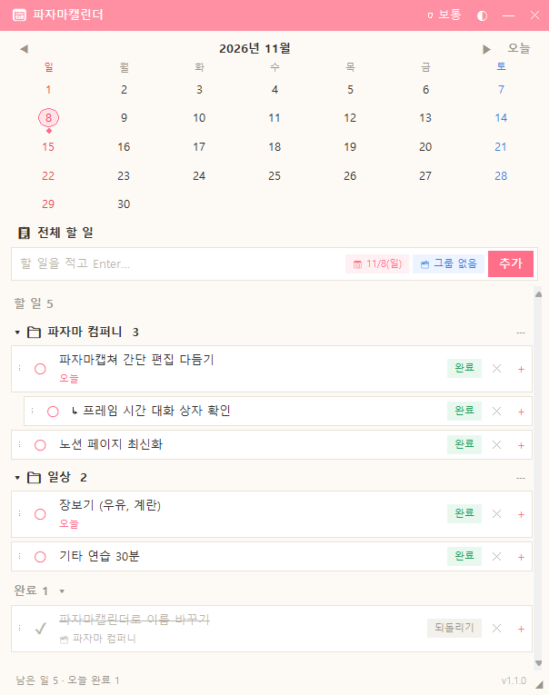
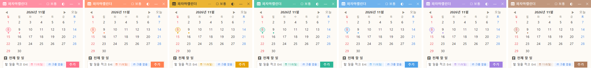

  

<h1 align="center">파자마캘린더 (PajamaCalendar)</h1>

  바탕화면에 작게 띄워 두고 쓰는 <b>할 일 + 달력 위젯</b>이에요. 
  할 일을 적고, 달력에서 날짜별로 확인하고, 그룹과 하위 할 일로 정리할 수 있어요.

  
  
  

  

---

## ⬇️ 받기

  <a href="https://github.com/hwangjinwook/PajamaCalendar/releases/latest"><b>👉 최신 버전 받으러 가기 (Releases)</b></a>

| 파일 | 설명 |
|---|---|
| `파자마캘린더.exe` | 프로그램 본체 |
| `파자마캘린더_제거.exe` | 프로그램·할 일 저장 폴더·바로가기·자동 실행 등록을 한 번에 지우는 제거 프로그램 |
| `README_사용설명서.txt` | 이 페이지와 같은 사용법 |

## 🚀 실행하기

1. 위 링크의 **Assets** 에서 `PajamaCalendar_v버전.zip` 을 받아요.
2. 원하는 폴더에 **압축을 풀어요.** zip 창 안에서 바로 실행하면 임시 폴더에서 열려 다음에 찾기 어려워요.
3. `파자마캘린더` 폴더의 `파자마캘린더.exe` 를 실행해요.
4. 처음 실행하면 윈도우를 켤 때 파자마캘린더도 자동으로 켜지도록 등록돼요. 바탕화면 바로가기가 필요하면 `파자마캘린더.exe` 를 오른쪽 클릭 → 보내기 → 바탕 화면에 바로 가기를 고르세요.

> 설치할 것은 없어요. 윈도우 10·11 에 기본으로 들어 있는 .NET Framework 4.8 로 실행돼요. 
> 「Windows의 PC 보호」 창이 뜨면 「추가 정보」 → 「실행」을 누르세요(디지털 서명이 없는 프로그램이라 나오는 안내예요).

## 📝 사용법

| 하고 싶은 일 | 방법 |
|---|---|
| 할 일 추가 | 입력칸에 적고 `Enter` |
| 한 번에 추가 | 여러 줄을 복사해 입력칸에 붙여넣기(`Ctrl+V`). 첫 줄은 그룹 제목, 그 아래 한 줄이 할 일 하나가 돼요 |
| 완료 / 되돌리기 | 왼쪽 ○ 를 누르면 완료, ✔ 를 누르면 다시 할 일로 |
| 고치기 / 삭제 | 글자를 두 번 눌러 고치기 / 오른쪽 ✕ 로 삭제 |
| 하위 할 일 | 항목 오른쪽 ＋ 또는 마우스 오른쪽 버튼 |
| 그룹 | 입력줄의 그룹 칩(🗂) → 「＋ 새 그룹 만들기…」 |
| 그룹 지우기 | 그룹 머리줄의 ⋯ → 「그룹 지우기」(할 일은 남김) 또는 「그룹과 할 일 모두 지우기」 |
| 순서 바꾸기 | 항목을 끌어서 다른 항목의 위·아래 가장자리(분홍 선)에 놓기 |
| 하위로 넣기 | 항목을 끌어서 다른 항목 줄의 가운데(연분홍으로 칠해짐)에 놓기 |
| 그룹 순서 바꾸기 | 그룹 머리줄(📁 줄)을 끌어서 다른 그룹 위·아래에 놓기 |
| 달력 | 날짜를 누르면 그날 할 일만, 다시 누르면 전체 보기 |
| 창 이동 / 크기 | 제목줄을 끌어 이동, 가장자리를 끌어 크기 조절 |
| 제목줄 버튼 | 창 배치(보통 / 항상 위 / 바탕화면 고정), ◐ 불투명도, — 접기, ✕ 닫기 |
| 자동 실행 | 윈도우를 켜면 함께 켜져요(기본 켜짐). ⋯ → 「⏹ 윈도우 시작 시 자동 실행 끄기」로 끌 수 있어요 |
| 메뉴(⋯) | 컬러 바꾸기, 이번 버전 새 기능, 지금 업데이트 확인, 새 버전 알림 끄기/켜기, 자동 실행 끄기/켜기, 저장 폴더 열기, 예전 데이터 가져오기 |

### 🎨 컬러 바꾸기

제목줄 ⋯ → 「🎨 컬러 바꾸기」에서 핑크(기본)·살구·레몬·민트·하늘·라벤더·코코아 중에 고르거나, 「직접 고르기…」로 원하는 색을 고를 수 있어요. 바로 바뀌고 다시 켜도 그대로예요.

  

## 💾 저장 위치

- 할 일은 윈도우 사용자 폴더의 `%APPDATA%\PajamaCalendar\todos.json` 에 저장돼요. 프로그램 폴더를 옮기거나 지워도 할 일은 남아요.
- ⋯ → 「📂 저장 폴더 열기」로 바로 열 수 있어요.
- 다른 PC로 옮기려면 `todos.json` 을 복사해 새 PC에서 ⋯ → 「📥 예전 데이터 가져오기…」로 고르세요.

## 🔔 업데이트

새 버전이 나오면 앱 제목줄에 작은 🔔 가 떠요. 누르면 달라진 점과 「받으러 가기」 단추가 나와요.
새 zip 을 받아 같은 방법으로 풀어 실행하면 되고, 할 일은 저장 폴더에 있어서 그대로 이어져요.

## 📜 버전 기록

| 버전 | 배포일 | 내용 |
|---|---|---|
| v2.8.0 | 2026-11-09 | 🚀 윈도우 시작 시 자동 실행(⋯ 메뉴에서 끄기/켜기). 📁 그룹 머리줄을 끌어서 그룹 순서 바꾸기(v2.7.0). 띄어쓰기가 유난히 넓게 보이던 문제 수정(v2.7.1) |
| v2.6.0 | 2026-11-08 | 🔔 새 버전 알림, ✨ 새 기능 안내. 이번 버전부터 GitHub 에서 받아요 |
| v2.5.0 | 2026-11-08 | 🎨 컬러 바꾸기(7가지 + 직접 고르기) |
| v2.4.0 | 2026-11-08 | 「그룹과 할 일 모두 지우기」 추가 |
| v2.3.0 | 2026-11-08 | 여러 줄 붙여넣기로 한 번에 추가 |
| v2.2.0 | 2026-11-08 | 제거 프로그램 `파자마캘린더_제거.exe` 추가 |
| v2.1.0 | 2026-11-08 | 할 일 저장 위치를 윈도우 사용자 폴더(`%APPDATA%\PajamaCalendar`)로 옮김 |
| v2.0.0 | 2026-11-08 | C# 으로 새로 만듦 — 배포 파일 약 10.4 MB → 약 73 KB, 더 빨리 켜짐 |
| v1.1.0 | 2026-11-08 | 「할 일 달력」 → 「파자마캘린더」 이름 변경, 끌어서 하위로 넣기 |
| v1.0.0 | 2026-11-07 | 첫 배포 |

---

  🩷 파자마 컴퍼니에서 만들었어요 · 이 저장소의 <code>version.json</code> 은 앱이 새 버전을 확인할 때 읽는 파일이에요. 지우거나 이름을 바꾸지 마세요.

